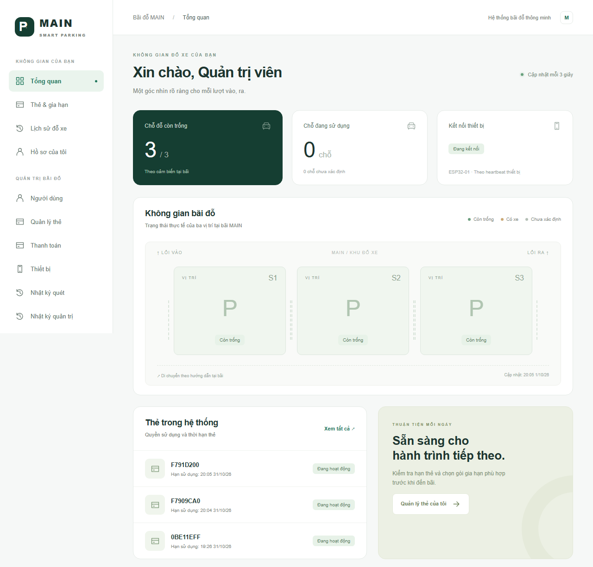
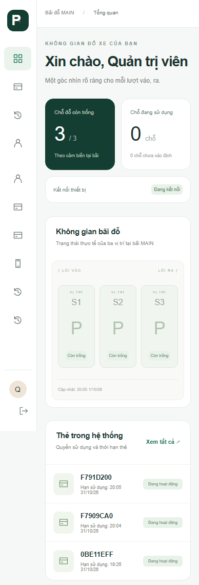
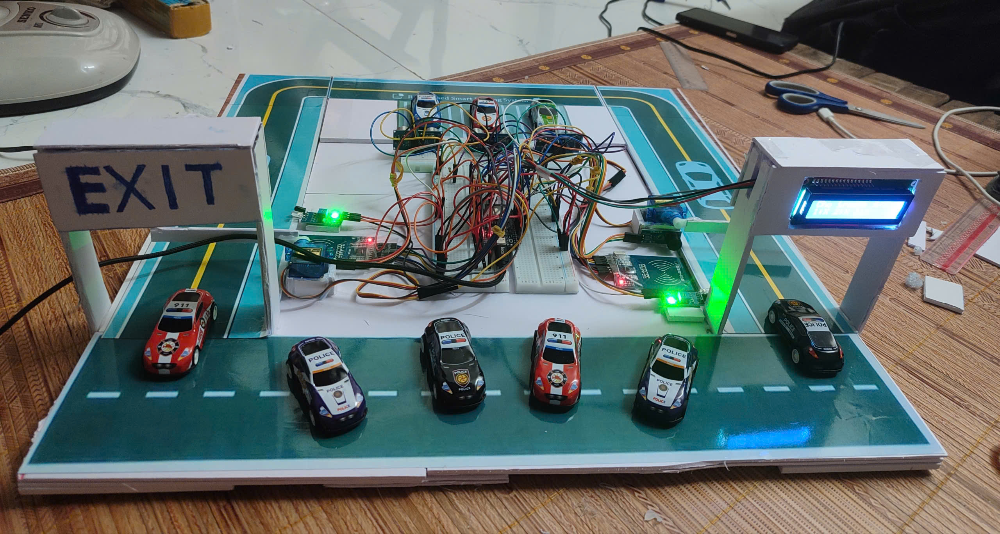

# MAIN Smart Parking

Hệ thống quản lý bãi đỗ xe thông minh gồm website cho người dùng và quản trị viên, API Spring Boot, PostgreSQL và thiết bị ESP32. Người dùng quản lý thẻ và lịch sử gửi xe; thiết bị gửi trạng thái cảm biến và yêu cầu xác thực thẻ về backend.

## Demo

### Website

<table>
  <tr>
    <td align="center" valign="top"><strong>Desktop</strong><br></td>
    <td align="center" valign="top"><strong>Mobile</strong><br></td>
  </tr>
</table>

### Mô hình phần cứng

<table>
  <tr>
    <td align="center" valign="top"><strong>Parking lot</strong><br></td>
  </tr>
</table>

### Tính năng

- **Người dùng:** đăng ký, đăng nhập, xem thẻ, gia hạn và tra cứu lịch sử gửi xe.
- **Quản trị viên:** quản lý người dùng và thẻ, theo dõi thanh toán, thiết bị, lượt quét và nhật ký quản trị.
- **Bãi xe:** hiển thị trạng thái ba vị trí đỗ; backend ghi nhận lượt vào/ra và áp dụng quy tắc thẻ.
- **ESP32:** đọc thẻ RFID, cảm biến và gửi yêu cầu xác thực tới backend.
- **Thanh toán:** chế độ mock hỗ trợ trình diễn luồng gia hạn; không thực hiện giao dịch tiền thật.

## Luồng hoạt động

1. Người dùng đưa thẻ RFID vào đầu đọc **IN** hoặc **OUT**.
2. ESP32 gửi UID, hướng quét và mã thiết bị đến backend qua Wi-Fi.
3. Backend xác thực thiết bị và thẻ, kiểm tra quy tắc lượt vào/ra, rồi trả về cho phép hoặc từ chối.
4. Nếu được cho phép, ESP32 điều khiển servo mở cổng; LCD và còi báo kết quả. Nếu bị từ chối hoặc mất kết nối, firmware không tự mở cổng.
5. ESP32 gửi heartbeat và trạng thái ba cảm biến chỗ đỗ. Website cập nhật tình trạng bãi và hiển thị lịch sử, nhật ký quét.

## Phần cứng

| Thành phần   | Số lượng | Kết nối chính                                                               |
| ------------ | -------: | --------------------------------------------------------------------------- |
| ESP32-WROOM  |        1 | Bộ điều khiển, Wi-Fi                                                        |
| RC522 RFID   |        2 | IN: SS 5/RST 16; OUT: SS 17/RST 33; SPI dùng chung SCK 18, MISO 19, MOSI 23 |
| Servo SG90   |        2 | Cổng IN GPIO 4; cổng OUT GPIO 32                                            |
| Cảm biến IR  |        2 | IN GPIO 34; OUT GPIO 35                                                     |
| HC-SR04      |        3 | S1: TRIG 27/ECHO 36; S2: 26/39; S3: 25/13                                   |
| LCD I2C 16×2 |        1 | SDA 21, SCL 22, địa chỉ 0x27                                                |
| Còi báo      |        2 | IN GPIO 15; OUT GPIO 14                                                     |

Các số trong bảng là số GPIO của ESP32, không phải vị trí chân trên header. HC-SR04 dùng nguồn 5 V; mỗi chân ECHO cần cầu chia áp trước khi nối vào ESP32. Cấp nguồn servo phù hợp và nối chung GND. Đây là mô hình bàn, không phải barrier an toàn cho xe thật.

## Công nghệ

| Thành phần    | Công nghệ                     |
| ------------- | ----------------------------- |
| Web           | Next.js, React, TypeScript    |
| Backend API   | Spring Boot, Java 21          |
| Cơ sở dữ liệu | PostgreSQL, Flyway            |
| Thiết bị      | ESP32, Arduino IDE, REST/JSON |

## Thiết lập dự án

### Chạy local trên Windows

Cần Java 21 và Node.js 24. Maven Wrapper đã có trong dự án. Từ thư mục gốc, tạo cấu hình môi trường và khởi động ứng dụng:

```powershell
.\scripts\init-env.ps1
.\scripts\start-local.ps1
```

Mở [http://localhost:3000](http://localhost:3000). Thông tin quản trị ban đầu được ghi trong `.env` (`ADMIN_USERNAME`, `ADMIN_PASSWORD`). Sau lần build đầu tiên, có thể khởi động bằng `.\scripts\start-local.ps1 -SkipBuild`. Dừng dịch vụ bằng `.\scripts\stop-local.ps1`.

### Chạy bằng Docker Compose

Khởi động Docker, tạo `.env` bằng `scripts/init-env.ps1` hoặc từ `.env.example`, sau đó chạy:

```powershell
docker compose up --build -d
```

Mở `http://localhost:3000`. Xem log bằng `docker compose logs -f backend`; `docker compose down` dừng stack và giữ lại volume dữ liệu.

### Nạp ESP32 bằng Arduino IDE

1. Cài Arduino IDE và board package **esp32 by Espressif Systems 2.0.17**.
2. Cài thư viện **MFRC522 1.4.12**, **ESP32Servo 1.1.2**, **LiquidCrystal_I2C 1.1.4**, **ElegantOTA 3.1.7** và **ArduinoJson 7.4.2**.
3. Mở `firmware/SPS_24_Doi_Cong/SPS_24_Doi_Cong.ino`; chọn **ESP32 Dev Module**, phân vùng 4 MB có OTA/Minimal SPIFFS và cổng COM của board.
4. Chép `firmware/parking_config.example.h` thành `parking_config.h` trong thư mục sketch. Cấu hình Wi-Fi, IPv4 LAN của máy chạy backend và device key.
5. Chọn **Verify**, sau đó **Upload**. Serial Monitor dùng baud rate 115200.

ESP32 và máy chạy backend cần cùng mạng LAN. Không điền `localhost` làm địa chỉ backend trong cấu hình thiết bị.

## Trạng thái

Website, backend và thanh toán mock phục vụ trình diễn. Thanh toán thật và phần cứng ESP32 cần được xác minh riêng trên tài khoản và thiết bị thực tế. Mô hình hiện tại không được xem là rào chắn an toàn cho xe thật.
